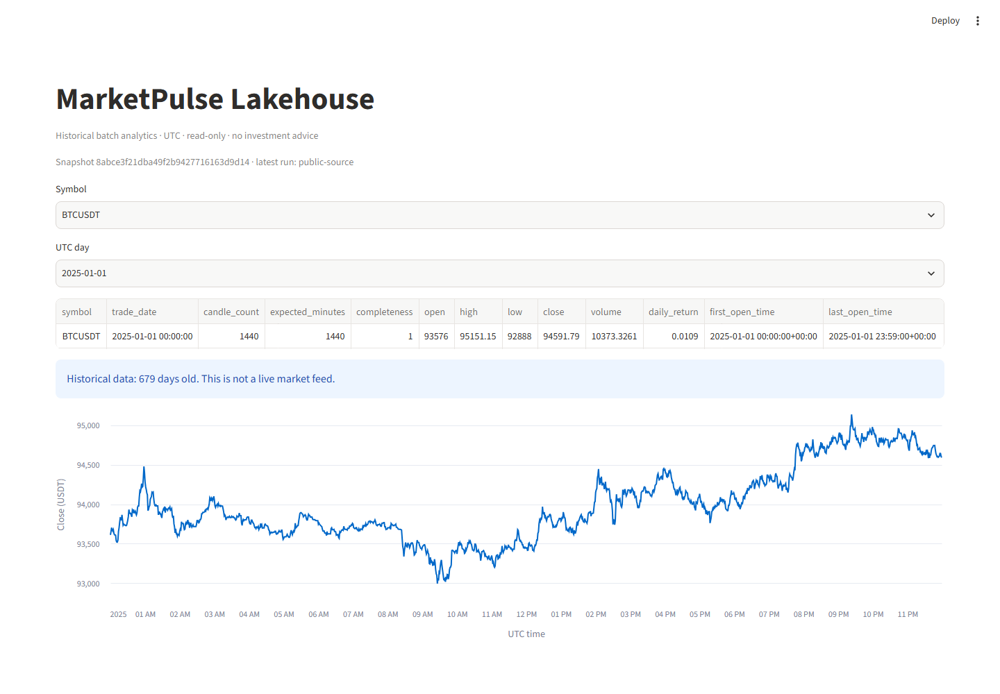

# One-day local batch core

Python 3.12 and uv are required. `uv sync --locked` installs the recorded versions.
No exchange accounts, API keys, Docker or paid services are required.

```powershell
uv run marketpulse make-fixture
uv run marketpulse batch-day --date 2024-01-01 --fixture-dir data/fixture
uv run marketpulse batch-day --date 2024-01-01 --fixture-dir data/fixture
uv run streamlit run src/marketpulse/dashboard.py --server.address 127.0.0.1
```

Each fixture run leaves nine unique candles, three per symbol, despite one
duplicate in each synthetic archive. Use a separate root for real public data:

```powershell
uv run marketpulse batch-day --date 2025-01-01 --dry-run
uv run marketpulse batch-day --date 2025-01-01 --root data/public-batch
uv run marketpulse batch-day --date 2025-01-01 --root data/public-batch
$env:MARKETPULSE_BATCH_ROOT = 'data/public-batch'
uv run streamlit run src/marketpulse/dashboard.py --server.address 127.0.0.1
```

One completed UTC date, one to three distinct supported pairs, six source files
including checksums, at most 1 MiB per ZIP and 2 MiB expanded per CSV. The planner
constructs only the fixed Binance spot/1m URLs. Public mode requires 1,440 unique
aligned minutes per symbol. Fixture mode intentionally permits incomplete days;
do not mix synthetic and public data in one root. All generated data is ignored.

[Binance's source specification](https://github.com/binance/binance-public-data)
defines microseconds from 1 January 2025; earlier spot archives use milliseconds.
The parser selects the explicit unit by archive date, checks date/minute bounds,
OHLC/volume rules, finite DECIMAL(38,8) values, and exact archive member/checksum.
Wrong units are rejected, not guessed. Duplicate identical keys are counted;
conflicting duplicates reject the batch. Invalid rows fail closed at the first
row with a source/row reason; broad row-level quarantine continues in December.

## Publication and recovery

An OS-owned writer lock serializes a root across processes and releases on exit
or crash. Never delete `.writer.lock` to bypass an active writer. Reads resolve
`current.json` once and open the snapshot's database read-only. Each candidate
run has a unique `runs/<id>/` directory containing raw archives, a copied prior
database, a fresh Parquet export and a reconciliation report. All requested
archives validate before any candidate load. The dlt bounded resource merges
every supplied `(symbol, interval, open_time)` key without the legacy global
cursor, so older-symbol backfills and explicit corrections are accepted.

Only after unique/database/Parquet counts match is `current.json` atomically
replaced. Download, checksum, row, database or export failures leave that pointer
and the previous snapshot untouched. `rejected.json` and candidate raw bytes stay
in the failed run for diagnosis. Incomplete/orphan runs are never automatically
promoted. A crashed run can be retried normally after its process releases the
lock. This local filesystem design does not claim distributed transactions or
power-loss durability. Old snapshots consume disk; retain them until readers
finish, then manually remove only known unused generations. Automated retention,
multi-month budgets and broader crash drills are later work.

## Analytics and checks

`marketpulse_data.typed_candles` exposes UTC timestamps, decimal prices/volumes,
provenance and business keys. Partitioned Parquet uses symbol and UTC date.
`marketpulse_data.daily_summary` calculates OHLC, base volume, return and minute
completeness. The dashboard filters symbol/date, shows partial/historical/error
states and reads only. It supplies no forecasts, live feed or investment advice.
The old sample CLI/database/cursor semantics remain separate and unchanged.

```powershell
uv run ruff check .
uv run ruff format --check src tests
uv run pytest -q
uv run marketpulse doctor
```

New clones retain LF text on Windows via `.gitattributes`, matching Ruff's
configured format. In an older CRLF checkout use `--config "format.line-ending='auto'"`
for a local format check, or use a fresh clone without rewriting user edits.
If a pre-existing system pytest temp directory is inaccessible,
create `artifacts/` and pass a fresh `--basetemp artifacts/check-<unique-name>`.
CI runs on a clean Linux checkout, without live public downloads.

Actual public-source dashboard, 11 November 2026:



The [CORE09 clean CLI/browser walkthrough](CLEAN_INTEGRATION.md) is verified with
separate native public-source and Linux offline evidence. The later
[bounded core audit](CORE_ACCEPTANCE.md) records acceptance; v0.1.0 is available.
The full December release remains open.

## Range planning

The always-read-only `plan-range` command enumerates candidate source files
without creating directories, reading databases, downloading files or modifying
existing data. Start is inclusive and end is exclusive. Dates must be canonical
`YYYY-MM-DD`, at least 2020-01-01, spanning 1–31 completed UTC days. The exclusive
end may be today in UTC. Pairs must be distinct BTCUSDT, ETHUSDT or SOLUSDT.

```powershell
uv run marketpulse plan-range --start 2025-01-01 --end 2025-02-01 --max-files 186 --max-bytes 100000000
```

Both budgets are required positive whole numbers. Every archive includes a
separate checksum entry: one ZIP is capped at 1,048,576 bytes and its checksum
at 1,024 bytes. This example plans 93 archives, 186 files in total and
97,612,800 payload bytes. A file budget of 185 or byte budget of 97,612,799
rejects the request with exit 2 and no partial JSON on stdout.

Files are ordered by date, sorted pair, then archive/checksum. Each entry has
its fixed Binance HTTPS URL, explicit ms/us timestamp unit, payload cap and
candidate relative path `raw/source=binance/symbol=<pair>/date=<date>/<filename>`.
There is no arbitrary host/path option. No files are written at these paths.
The output records the supplied budgets and that source availability was not
checked. Reordering supplied pairs produces the same manifest.

These are accepted source-file payload caps, not observed file sizes, retry
traffic, expanded CSV or warehouse/snapshot storage estimates. No source
existence check or actual month ingestion occurs. The daily `batch-day`
workflow above remains the execution path; M09 will add and verify month
execution and resource accounting separately.

Reproduce the installed CLI walkthrough in a new artifact directory:

```powershell
uv run python scripts/demo_plan.py --artifacts artifacts/month-plan
```

It runs the actual CLI, checks the full month and five invalid requests,
verifies repeatability and preserves sentinel pointer/database bytes and the
entire existing data-file set. It writes a canonical UTF-8/LF manifest and
verification report only to the explicitly requested new artifact directory.
CI retains both JSON files alongside the existing offline core integration.
