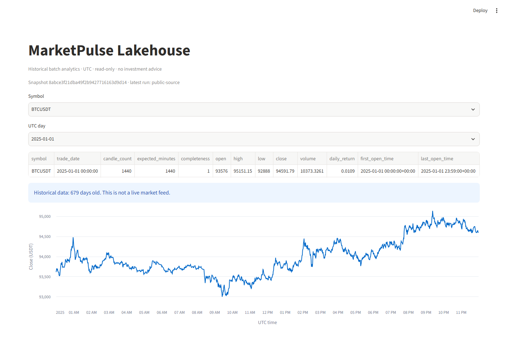

# One-day local batch core

Python 3.12 and uv are required. `uv sync --locked` installs the recorded versions.
No exchange accounts, API keys, Docker or paid services are required.

```powershell
uv run marketpulse make-fixture
uv run marketpulse batch-day --date 2024-01-01 --fixture-dir data/fixture
uv run marketpulse batch-day --date 2024-01-01 --fixture-dir data/fixture
uv run streamlit run src/marketpulse/dashboard.py --server.address 127.0.0.1
```

Each fixture run leaves nine unique candles, three per symbol, despite one
duplicate in each synthetic archive. Use a separate root for real public data:

```powershell
uv run marketpulse batch-day --date 2025-01-01 --dry-run
uv run marketpulse batch-day --date 2025-01-01 --root data/public-batch
uv run marketpulse batch-day --date 2025-01-01 --root data/public-batch
$env:MARKETPULSE_BATCH_ROOT = 'data/public-batch'
uv run streamlit run src/marketpulse/dashboard.py --server.address 127.0.0.1
```

One completed UTC date, one to three distinct supported pairs, six source files
including checksums, at most 1 MiB per ZIP and 2 MiB expanded per CSV. The planner
constructs only the fixed Binance spot/1m URLs. Public mode requires 1,440 unique
aligned minutes per symbol. Fixture mode intentionally permits incomplete days;
do not mix synthetic and public data in one root. All generated data is ignored.

[Binance's source specification](https://github.com/binance/binance-public-data)
defines microseconds from 1 January 2025; earlier spot archives use milliseconds.
The parser selects the explicit unit by archive date, checks date/minute bounds,
OHLC/volume rules, finite DECIMAL(38,8) values, and exact archive member/checksum.
Wrong units are rejected, not guessed. Duplicate identical keys are counted;
conflicting duplicates reject the batch. Invalid rows fail closed at the first
row with a source/row reason; broad row-level quarantine continues in December.

## Publication and recovery

An OS-owned writer lock serializes a root across processes and releases on exit
or crash. Never delete `.writer.lock` to bypass an active writer. Reads resolve
`current.json` once and open the snapshot's database read-only. Each candidate
run has a unique `runs/<id>/` directory containing raw archives, a copied prior
database, a fresh Parquet export and a reconciliation report. All requested
archives validate before any candidate load. The dlt bounded resource merges
every supplied `(symbol, interval, open_time)` key without the legacy global
cursor, so older-symbol backfills and explicit corrections are accepted.

Only after unique/database/Parquet counts match is `current.json` atomically
replaced. Download, checksum, row, database or export failures leave that pointer
and the previous snapshot untouched. `rejected.json` and candidate raw bytes stay
in the failed run for diagnosis. Incomplete/orphan runs are never automatically
promoted. A crashed run can be retried normally after its process releases the
lock. This local filesystem design does not claim distributed transactions or
power-loss durability. Old snapshots consume disk; retain them until readers
finish, then manually remove only known unused generations. Automated retention,
multi-month budgets and broader crash drills are later work.

## Analytics and checks

`marketpulse_data.typed_candles` exposes UTC timestamps, decimal prices/volumes,
provenance and business keys. Partitioned Parquet uses symbol and UTC date.
`marketpulse_data.daily_summary` calculates OHLC, base volume, return and minute
completeness. The dashboard filters symbol/date, shows partial/historical/error
states and reads only. It supplies no forecasts, live feed or investment advice.
The old sample CLI/database/cursor semantics remain separate and unchanged.

```powershell
uv run ruff check .
uv run ruff format --check src tests
uv run pytest -q
uv run marketpulse doctor
```

On a Windows CRLF checkout use `--config "format.line-ending='auto'"` for the
format check. If a pre-existing system pytest temp directory is inaccessible,
create `artifacts/` and pass a fresh `--basetemp artifacts/check-<unique-name>`.
CI runs on a clean Linux checkout, without live public downloads.

Actual public-source dashboard, 11 November 2026:



Final clean-clone walkthrough and evidence audit remain CORE09/CORE-ACCEPT.
No complete-core release tag is implied by the current batch slice.
